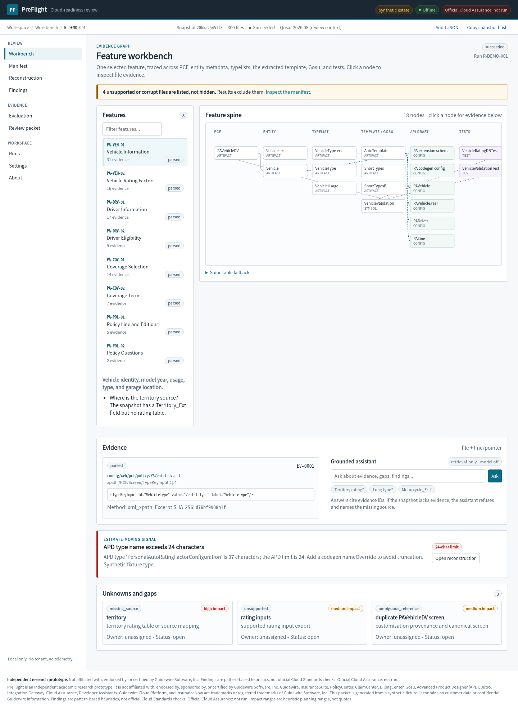
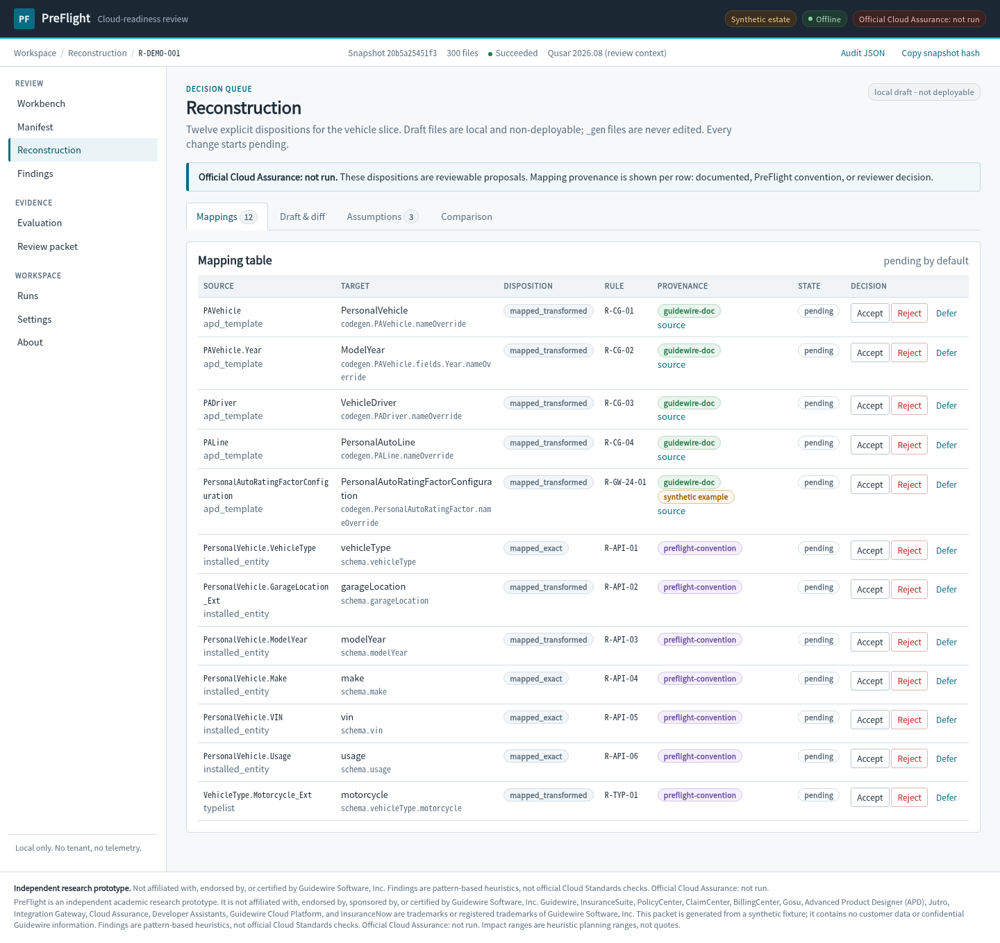
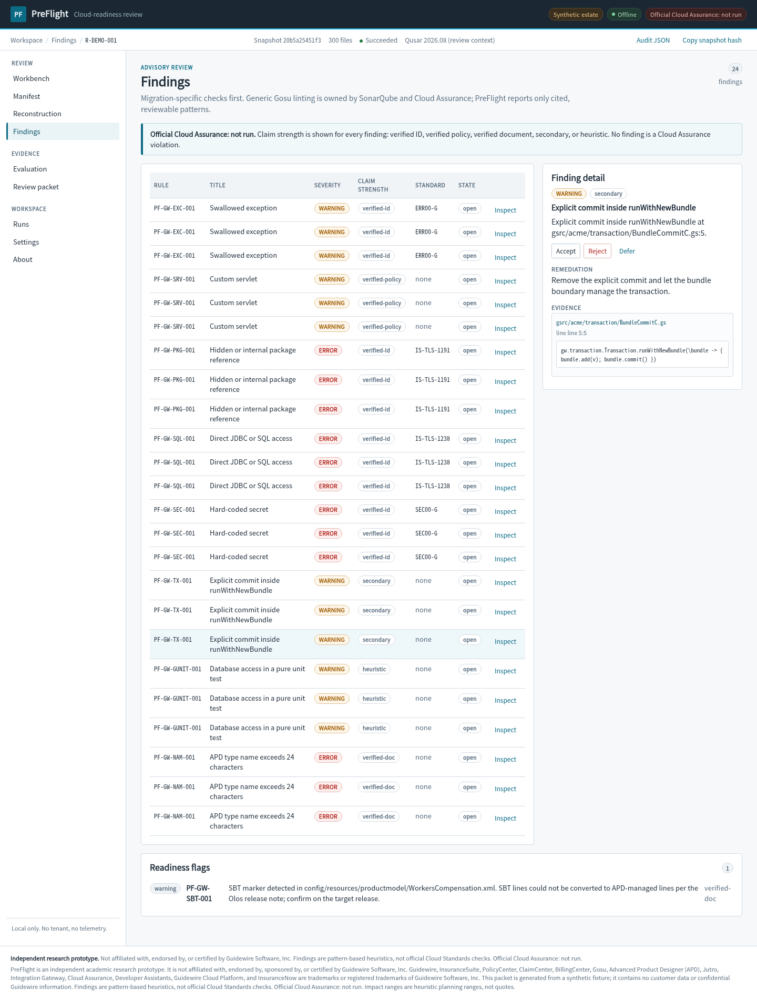
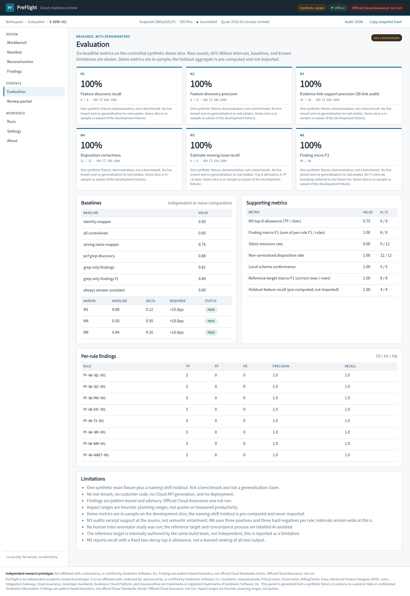
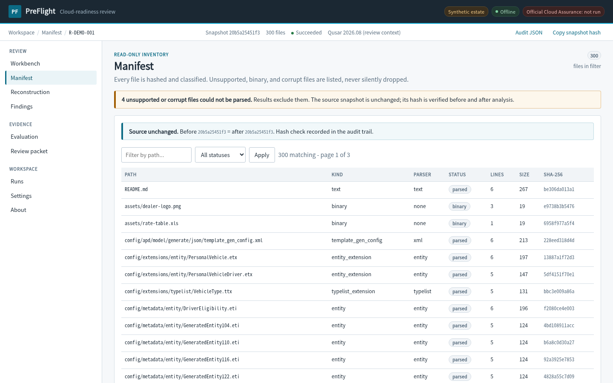
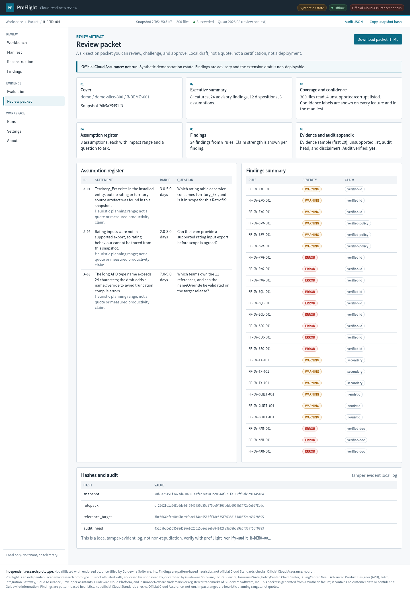

# PreFlight

**Independent Cloud-Readiness Review for Guidewire-Style Insurance Estates**

PreFlight is an offline, evidence-first review workstation for legacy Guidewire-style policy administration estates. It assembles business features across PCF, entity metadata, typelists, extracted templates, Gosu, and Cloud API configuration; links every claim to file evidence; surfaces documented blockers and evidence gaps; and produces a reviewable local Cloud API extension draft plus an impact-rated assumption register for one feature slice.

> Every claim has evidence; every unknown has a name; every change waits for a human.

**[Snapshot `v1.0.0`](https://github.com/SaundaryaSingh/Preflight-CloudMigration/releases/tag/v1.0.0)** · **Synthetic demo estate** · **Official Cloud Assurance: not run**

[](https://github.com/SaundaryaSingh/Preflight-CloudMigration/actions/workflows/ci.yml)




---

## The problem

A Guidewire migration estimate is only as good as its inventory. Before an APD conversion or Cloud Retrofit engagement, teams need to know:

- What customisation actually exists across PCF, entities, typelists, templates, Gosu, tests, and API configuration?
- Which business feature does each artefact belong to?
- Which fields have an explicit target disposition, and which are silently missing?
- Which documented blockers will move the estimate?
- What exactly is unknown, who owns the question, and what evidence would answer it?

Generic linters answer none of those questions. PreFlight is built around the inventory, the evidence graph, and the review packet.

## What PreFlight does

1. **Inventories every file** in a read-only snapshot, hash, parser status, unsupported/corrupt files, and source immutability check.
2. **Assembles feature candidates** across PCF screens, installed entities, typelists, extracted APD templates, Gosu, and GUnit tests.
3. **Links every claim to evidence** with a file path and line/pointer, excerpt, method, confidence, and excerpt hash.
4. **Reviews migration-specific patterns** with claim-strength labels: verified standard ID, verified policy, verified document, secondary, or heuristic.
5. **Reconstructs a local Cloud API extension draft** for one feature slice: `_ext` schema, mapping, updater, codegen config, and product access file.
6. **Produces explicit dispositions** for source properties and turns unresolved items into an assumption register with impact ranges and questions to ask.
7. **Benchmarks the method** on frozen synthetic fixtures with a sealed reference target, baselines, hard negatives, and a naming-shift holdout.
8. **Exports a review packet** with evidence, assumptions, findings, hashes, and a hash-chained audit trail.
9. **Runs a bounded multi-agent migrator** over the completed review: Scout scopes the feature, Architect generates target files, Guardian opens risk gates, Critic verifies the output, and Scribe seals the plan, report, and bundle manifest. Every change stays pending approval.

## Autonomous migrator

The `/migrator` page is a live five-agent orchestration over a completed run. It
generates a reviewable migration bundle in `data/runs/<run>/migration/`, with
its own hash-chained agent log, and reports `completed_with_gates` while human
decisions remain open. It does not deploy, edit `_gen` files, approve its own
changes, or contact a tenant.

```bash
make demo
# http://127.0.0.1:8000/migrator?run=R-DEMO-001
.venv/bin/python -m app.cli migrate R-DEMO-001
.venv/bin/python -m app.cli verify-migration R-DEMO-001
```

See [`docs/MIGRATOR.md`](docs/MIGRATOR.md).

## What it is not

- It does not convert products to APD.
- Not a Cloud Retrofit replacement.
- Not an official Cloud Assurance score, pass, or certification.
- Not a generic Gosu linter; SonarQube and Cloud Assurance own generic linting.
- Not a live-tenant connector or deployment tool.
- The **Migrator** is an autonomous draft generator: it produces a local, non-deployable target bundle and leaves every change pending human approval.
- The extension draft is **local and non-deployable**.

## Snapshot

| Item | Value |
|---|---|
| Version | `v1.0.0` |
| Date | 2026-11-08 |
| Demo run | `R-DEMO-001` |
| Fixture | `demo-slice-300` (300 synthetic files) |
| Feature slice | `PA-VEH-01` Vehicle Information |
| Features | 8 |
| Advisory findings | 24 from 8 rules |
| Mappings | 12 explicit dispositions |
| Assumptions | 3 |
| Tests | 421 passing |
| Frozen evaluation hashes | `ground_truth/FROZEN.json` |
| Review packet | [`docs/demo/preflight-review-packet.html`](docs/demo/preflight-review-packet.html) |
| Run summary | [`docs/demo/run-summary.json`](docs/demo/run-summary.json) |

### Measured snapshot

| Metric | Result | Caveat |
|---|---:|---|
| M1 Feature recall | 8 / 8 | In-sample synthetic demo slice |
| M2 Feature precision | 8 / 8 | In-sample synthetic demo slice |
| M3 Evidence-link support precision | 101 / 101 | All-link audit; 30/30 stratified sample is supporting only. Excerpt support, not semantic entailment |
| M4 Disposition correctness | 12 / 12 | Source + target + disposition; extras penalised |
| M5 Estimate-moving issue recall | 6 / 6 | Top-8 allowance is 6 TP / 8 slots (2 fixed decoys) |
| M6 Finding micro-F1 | 48 / 48 | 8 rules × 3 positives + 3 hard negatives |

These are controlled synthetic-fixture measurements, not a benchmark and not a generalisation claim. The naming-shift holdout is pre-computed and never imported into the demo.

## Product tour

| Workbench | Reconstruction |
|---|---|
|  |  |

| Findings | Evaluation |
|---|---|
|  |  |

| Manifest | Review packet |
|---|---|
|  |  |

## Quick start

Requirements: Linux/macOS, Python 3.12, `uv`, and `tmux` for the demo server.

```bash
git clone https://github.com/SaundaryaSingh/Preflight-CloudMigration.git
cd Preflight-CloudMigration
make install       # create .venv, install deps, download Chromium
make demo          # generate fixtures, seed R-DEMO-001, start tmux server
```

Open:

**http://127.0.0.1:8000/?run=R-DEMO-001**

The demo server auto-restarts if it is stopped inside tmux. The launcher pins a local-only
`PREFLIGHT_SECRET_KEY` so an already-open page keeps its CSRF token across those restarts;
normal production runs still use the random per-process fallback. Leave it in the background:

```text
Ctrl+b, then d
```

Stop it deliberately:

```bash
make stop
```

Foreground alternative:

```bash
make demo-fg
```

## Five-minute judge demo

The full runbook is in [`docs/DEMO-SCRIPT.md`](docs/DEMO-SCRIPT.md).

| Time | Screen | Beat |
|---|---|---|
| 0:00 | Workbench | 300 files, hashed and read-only; summary strip; feature spine; click a node for evidence |
| 0:30 | Manifest | 4 excluded files listed with reasons (2 binary, 1 corrupt, 1 unsupported); source hash unchanged |
| 1:00 | Workbench | Eight feature inventories; PA-VEH-01 opens the territory gap |
| 1:30 | Reconstruction | 12 dispositions; accept one, reject one; new assumption appears inline; audit |
| 2:45 | Findings | 24 findings from 8 rules; claim strength; precision guards; SBT flag |
| 3:30 | Assistant | Back on Workbench; territory question refuses; `Motorcycle_Ext` answer cites evidence cards |
| 4:00 | Evaluation | Six metrics, intervals, baselines, per-rule table, limitations |
| 4:30 | Packet | Six sections, owner/status, hashes, audit head, downloadable HTML |
| 4:50 | Close | “Every claim has evidence; every unknown has a name; every change waits for a human.” |

## Architecture

```text
Snapshot
  → Intake        manifest, hashes, classification, unsupported files
  → Parse         PCF, entity, typelist, product/template XML, YAML, Gosu scanner
  → Discover      feature candidates, evidence graph, confidence, gaps
  → Review        8 demo rules with masking, allowlists, hard negatives
  → Reconstruct   12 mapping rules, local _ext draft, diff, assumptions
  → Compare       preserved / changed / missing / added / unresolved
  → Evaluate      M1–M6, baselines, margins, per-rule table
  → Packet        six-section review artifact, hashes, audit head
  → Migrator      five-agent draft bundle, gates, verification, sealed manifest
```

**Stack:** Python 3.12 · FastAPI · Jinja2 · vanilla JS/CSS · `lxml` · `ruamel.yaml` · Pydantic v2 · JSON run store · pytest · Playwright.

**Invariants:**

- Source snapshots are read-only and hashed before and after analysis.
- `_gen` files are never edited; only `_ext`, codegen, and product-access drafts are proposed.
- Every draft change starts `pending`.
- Every feature has at least one parsed anchor.
- Unsupported, binary, and corrupt files are listed, never silently dropped.
- No external calls, no telemetry, no live tenant, no LLM required.

## Repository layout

```text
app/                 FastAPI routes, Pydantic contracts, services, templates, static assets
app/services/        intake, parsers, discovery, reconstruction, review, compare, evaluate, assistant
rules/               feature, mapping, and review rule packs
fixtures/            synthetic main estate, demo slice, naming-shift holdout
ground_truth/        pre-registration, frozen hashes, gold labels, reference target
docs/                claims ledger, target format, security contract, demo runner, verification
docs/demo/           review-packet snapshot and run summary
templates/target/    local target contracts
scripts/             fixture generator, seed, freeze, claims lint, demo server
tests/               unit, API, security, adversarial precision, pipeline, and Playwright tests
plans/               vetted planning contract and build handoff
```

## Evidence and review rules

Demo rules:

- `PF-GW-SQL-001` — direct JDBC/SQL (`IS-TLS-1238`)
- `PF-GW-SEC-001` — hard-coded secret (`SEC00-G`)
- `PF-GW-PKG-001` — hidden/internal package (`IS-TLS-1191`)
- `PF-GW-EXC-001` — swallowed exception (`ERR00-G`)
- `PF-GW-TX-001` — explicit commit inside `runWithNewBundle` (secondary)
- `PF-GW-SRV-001` — custom servlet (verified policy)
- `PF-GW-NAM-001` — APD type name over 24 characters (verified document)
- `PF-GW-GUNIT-001` — database access in a pure unit test (heuristic)

`PF-GW-SBT-001` is a separate readiness flag for Standards Based Template estates.

Every finding carries a claim-strength label. No finding is presented as a Cloud Assurance violation. **Official Cloud Assurance: not run.**

## Reconstruction slice

`PA-VEH-01` traces:

- PCF `PAVehicleDV.pcf`
- installed entity `PersonalVehicle.eti`
- extension `PersonalVehicle.etx`
- typelist `VehicleType.tti` / `.ttx`
- extracted template `PersonalAutoTemplate.xml`
- Gosu validation and tests
- 12 explicit dispositions
- territory gap and rating-input gap as assumptions
- long type `PersonalAutoRatingFactorConfiguration` (37 characters) with a synthetic-example label

## Testing

```bash
make test       # full suite: 421 tests
make e2e        # Playwright golden path
make claims     # claims-ledger and rule-coverage gate
make verify     # hash-chained audit verification
make lint       # compile + claims lint
```

Coverage includes:

- Pydantic contracts and serialization
- intake safety (zip-slip, symlink, ratio, corrupt XML)
- parser line/pointer evidence
- feature discovery and holdout isolation
- reconstruction, mapping rule pack, local schema conformance
- adversarial false-positive gates for every review rule
- API, CSRF, Host/Origin, CSP, XSS, secret redaction
- full pipeline, packet, audit chain
- browser golden path, offline network check, screenshots

## Internal QA and adversarial review

The full record is in [`docs/VERIFICATION.md`](docs/VERIFICATION.md).

| Gate | Result |
|---|---|
| Demo-readiness panel | Four independent reviewers: 7/10 (Loop 2); demo hardening continues |
| Product gate | Internal QA: core flow, packet, and audit gates pass |
| Claims / precision / reproducibility | Claims lint OK; freeze hashes 18/18 recompute |
| Freeze hashes | 18/18 recompute |
| Audit chain | `R-DEMO-001: OK` |

The full adversarial record is historical and is being updated for the current build. It is internal QA, not an independent third-party certification.

## Data, security, and boundaries

- Local-only bind (`127.0.0.1`), Host/Origin allowlist, CSRF token, SameSite=Strict.
- CSP, Jinja autoescape, no inline event handlers.
- Zip extraction rejects traversal, symlinks, encryption, NUL, drive letters, and compression bombs.
- XML parsing disables entities, DTD, network, and huge trees.
- YAML rejects tags; config uses safe loading.
- Secrets are redacted at capture; only a fingerprint is stored.
- Review log is hash-chained and verifiable; it is not non-repudiation.
- No customer data, tenant, credentials, telemetry, or external calls.
- Synthetic fixtures only; no confidential Guidewire content is redistributed.

## Known limitations

- The reference target is internally authored and AI-assisted; it is not independently blind.
- Demo metrics are in-sample on the development slice; the holdout is pre-computed and naming-shift only.
- M3 audits excerpt support at the source, not semantic entailment.
- M5 uses a fixed two-decoy top-8 allowance, not a learned ranking.
- M6 line-level matching is deferred; the demo uses path-level matching.
- No human inter-annotator study; no reviewer-effort or real-estate generalisation claim.
- The thesis-tier protocol is planned, not delivered; this snapshot is a demo-tier feasibility study. See [`docs/EVALUATION-SCOPE.md`](docs/EVALUATION-SCOPE.md).
- The extension draft is local and non-deployable; it is not compiled or tenant-validated.

## Claims and legal

PreFlight is an independent academic research prototype. It is not affiliated with, endorsed by, sponsored by, or certified by Guidewire Software, Inc.

Guidewire, InsuranceSuite, PolicyCenter, ClaimCenter, BillingCenter, Gosu, Advanced Product Designer (APD), Jutro, Integration Gateway, Cloud Assurance, Developer Assistants, Guidewire Cloud Platform, and InsuranceNow are trademarks or registered trademarks of Guidewire Software, Inc. in the United States and/or other countries. All other trademarks belong to their owners.

All fixtures are synthetic. Findings are pattern-based heuristics, not official Cloud Standards checks, and are not legal, security, or compliance advice. Impact ranges are heuristic planning ranges, not quotes. **Official Cloud Assurance: not run.**

The canonical claims ledger is [`docs/claims-ledger.json`](docs/claims-ledger.json); the Markdown version is generated.

## License

MIT — see [`LICENSE`](LICENSE).

## Citation

```bibtex
@software{preflight2026,
  title  = {PreFlight: Independent Cloud-Readiness Review for Guidewire-Style Estates},
  author = {Singh, Saundarya},
  year   = {2026},
  url    = {https://github.com/SaundaryaSingh/Preflight-CloudMigration},
  note   = {Offline evidence-first review prototype; synthetic fixtures}
}
```
